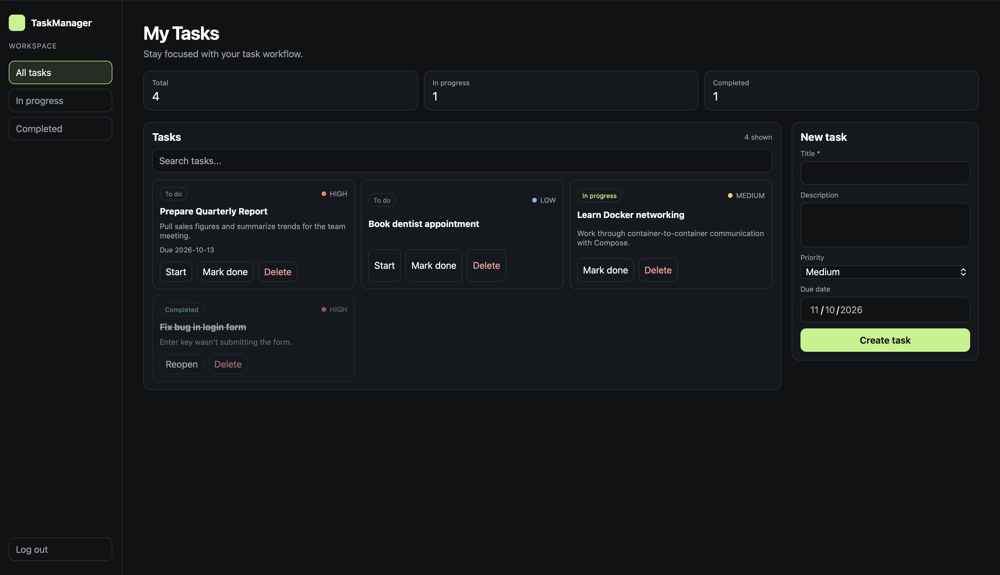

# TaskManager

A full-stack task management application with a secured REST API and a React frontend. Users register, log in, and manage their own tasks: create them, move them through a simple workflow (to do → in progress → done), and delete them. Each user can only ever see and modify their own data.



## Features

- **JWT authentication.** Stateless registration and login; passwords hashed with BCrypt.
- **Per-user data isolation.** Every task endpoint enforces ownership on the server. Users never see or modify another user's tasks.
- **Full task CRUD.** Create, read, partially update (`PATCH`), and delete, with a `TODO → IN_PROGRESS → DONE` workflow.
- **Validation and consistent errors.** Request validation with field-level messages; a global exception handler returns a uniform JSON error shape with correct status codes (400, 401, 404, 409).
- **Interactive API docs.** Swagger UI generated from the code, with JWT authorization built in.
- **Tested.** Unit tests with Mockito, plus integration tests that run against a real PostgreSQL instance via Testcontainers.
- **Containerized.** The API and database run together with a single `docker compose` command; secrets are supplied through environment variables.
- **React frontend.** Login and registration, a responsive dashboard with search and status filters, protected routes, and automatic redirect to login when a session expires.

## Tech stack

**Backend:** Java 21 · Spring Boot 4 · Spring Security · JWT (jjwt) · Spring Data JPA / Hibernate · PostgreSQL · Bean Validation · springdoc-openapi (Swagger UI) · Gradle

**Testing:** JUnit 5 · Mockito · Testcontainers · Spring MockMvc

**Frontend:** React · Vite · React Router

**Infrastructure:** Docker · Docker Compose

## Architecture

The backend follows a layered architecture. Controllers handle HTTP only, services hold the business rules, and repositories handle persistence. DTOs form the API contract, so JPA entities are never exposed directly.

```
Request → JwtAuthFilter → Controller → Service → Repository → PostgreSQL
                              ↑            ↓
                         Request DTO   Response DTO
```

```
src/main/java/com/task_manager/
├── config/        # Security, CORS, and OpenAPI configuration
├── controller/    # REST endpoints
├── dto/           # Request and response records
├── entity/        # JPA entities (User, Task, Project) and enums
├── exception/     # Custom exceptions and global exception handler
├── repository/    # Spring Data JPA repositories
├── security/      # JWT utility, authentication filter, user details
└── service/       # Business logic

frontend/src/
├── App.jsx            # Routes and protected-route wrapper
├── LoginPage.jsx
├── RegisterPage.jsx
└── TasksPage.jsx      # Dashboard
```

## Getting started

### Prerequisites

- Java 21
- Node.js 18 or newer
- Docker Desktop (running)

### 1. Configure secrets

Copy the example environment file and fill in your own values:

```bash
cp .env.example .env
```

Generate a JWT signing secret and paste it into `.env` as `JWT_SECRET`:

```bash
openssl rand -base64 32
```

`.env` is git-ignored, so your secrets never leave your machine.

### 2. Start the backend and database

```bash
./gradlew bootJar
docker compose up --build
```

The API runs at `http://localhost:8080`. PostgreSQL runs in its own container, and the schema is created automatically on first start.

### 3. Start the frontend

In a second terminal:

```bash
cd frontend
npm install
npm run dev
```

Open `http://localhost:5173`, create an account, and you're in.

### Running the backend without Docker

If you'd rather use a local PostgreSQL install, create a database named `taskmanager`, then set `SPRING_DATASOURCE_URL`, `SPRING_DATASOURCE_USERNAME`, `SPRING_DATASOURCE_PASSWORD`, and `JWT_SECRET` as environment variables and run:

```bash
./gradlew bootRun
```

## API documentation

With the backend running, open **[http://localhost:8080/swagger-ui.html](http://localhost:8080/swagger-ui.html)**.

To call protected endpoints from Swagger: register or log in, copy the `token` from the response, click **Authorize**, and paste it in.

| Method | Endpoint | Auth | Description |
|---|---|---|---|
| `POST` | `/api/auth/register` | No | Create an account; returns a token |
| `POST` | `/api/auth/login` | No | Log in; returns a token |
| `GET` | `/api/tasks` | Yes | List the current user's tasks |
| `GET` | `/api/tasks/{id}` | Yes | Get one task |
| `POST` | `/api/tasks` | Yes | Create a task |
| `PATCH` | `/api/tasks/{id}` | Yes | Update any subset of a task's fields |
| `DELETE` | `/api/tasks/{id}` | Yes | Delete a task |

## Running the tests

Docker must be running, since the integration tests start a PostgreSQL container.

```bash
./gradlew test
```

- **Unit tests** cover `TaskService` and `AuthService` with mocked repositories, including verification that passwords are hashed before they're saved and that users can't read another user's tasks.
- **Integration tests** boot the full application against a real PostgreSQL container and exercise the complete register → authenticate → protected request flow.

## Design decisions

- **Stateless JWT authentication.** The server stores no sessions, so any instance can validate any request. Tokens expire after one hour.
- **Ownership enforced server-side.** The task owner always comes from the authenticated token, never from the request body. Requests for another user's task return 404 rather than 403, so the API doesn't reveal which task IDs exist.
- **`PATCH` for updates.** Clients send only the fields they want to change, which matches how the UI works (for example, "Mark done" sends only the status).
- **DTOs at the boundary.** Entities stay internal, so sensitive fields like password hashes can't leak, and clients can't set fields like `id` or `owner`.
- **Secrets from the environment.** No real credentials are committed. Configuration falls back to development-only defaults for local runs.

## Known limitations and future improvements

- **Projects** exist in the data model but don't yet have API endpoints or a UI.
- **Editing** a task's title, description, or due date is supported by the API but not yet by the frontend.
- **Token storage.** The JWT is kept in `localStorage`, which is simple but exposed to XSS. An httpOnly cookie with CSRF protection would be more robust.
- **No refresh tokens or revocation.** Users log in again when a token expires, and a token can't be invalidated before expiry.
- **Schema management** uses Hibernate's `ddl-auto: update`. A migration tool such as Flyway would be the production choice.
- **Frontend configuration.** The API URL is hard-coded and should move to an environment variable; the frontend isn't containerized yet.
- **No pagination** on the task list, and no CI pipeline yet.

## Author

Artem Shnyrov · [GitHub](https://github.com/Artem-Shnyrov)